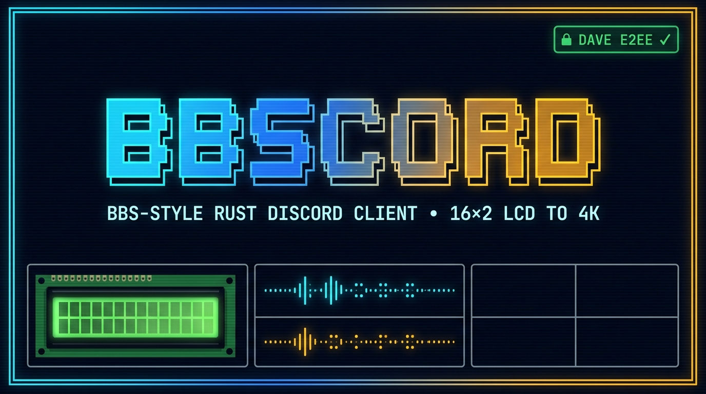

<div align="center">



# bbscord

**Old-school BBS soul. `btop` polish. Zero wasted cells.**

*A blazing-fast, memory-safe Rust Discord terminal client that scales dynamically from a **16×2 character LCD** all the way to **dual-2K & 4K ultrawide cockpits**.*

[](https://github.com/Bit-Loop/bbscord/actions/workflows/ci.yml)
[](https://www.rust-lang.org/)
[](#architecture--security)
[](#highlights)
[](LICENSE)

[Install](#-install) • [Usage](#-usage) • [Highlights](#-highlights) • [Keybinds](#-essential-keybinds) • [Themes](#-btop-compatible-themes) • [Architecture](#-architecture--security)

</div>

---

## ✨ Highlights

- **Continuous `16×2` LCD → `4K` Dynamic Layout:** Drops all borders into a 6-key, 7-bit HD44780 ASCII pager on a `16×2` display, renders classic `80×24` CP437 `╔═╗` BBS chrome in standard terminals, and expands into a clamped 3-deck cockpit on dual-2K (`512×144`) & `4K` monitors—with live `SIGWINCH` reflow and zero scroll drift.
- **Voice, Group DMs & Mandatory DAVE E2EE:** Full Guild Voice, Stage channels, **and** 1:1 / Group DM calls (`type = 3`, create/add/remove/rename/ring) with **DAVE MLS E2EE** (`davey`), SAS verification codes, 48 kHz Opus audio, VAD + Push-to-Talk, `0–200%` per-user volume mixing, Braille VU meters, and inline voice-message waveform playback.
- **Go Live Screensharing (Watch & Broadcast):** Wayland/X11 XDG Desktop Portal + PipeWire capture, hardware-accelerated H.264/VP8 encoding, GStreamer WebRTC + DAVE frame encryption, and dual watch sinks (smooth 60 fps borderless `mpv` pop-out **or** inline terminal video stage).
- **Animated GIFs & Rich Embeds:** Multi-frame inline GIF playback, modal GIF search powered by Discord's native `/gifs` endpoint (+ optional Klipy/Giphy keys), 3-column inline embed grids, link-card thumbnails, syntax-highlighted code blocks, and live polls.
- **`btop`-Style Live Themes:** 10 built-in BBS & CRT themes **plus** automatic discovery of your existing `btop` `.theme` files. Press **`F2`** to live-repaint the entire UI with 3-stop OKLab gradients and Braille sparklines.
- **Works in Every Terminal:** Auto-negotiates **Kitty Placeholders** (`kitty`, `Ghostty`, `Rio`), **Kitty Direct** (`WezTerm`, `Konsole`), **Sixel** (`foot`, `Windows Terminal`, `xterm`), **iTerm2** (`OSC 1337`), **24-bit Half-Blocks** (`Alacritty`, `GNOME Terminal`, `tmux`, `zellij`), Linux VT (`TERM=linux`), and raw serial/dumb TTYs.

---

## 🖥️ Preview

**Classic `80×24` CP437 BBS Mode** *(braille latency graph, DAVE E2EE badge, link-card preview, voice waveform, polls)*:

```text
╔═╡¹guilds╞════════╦═╡²#general-bbs · Welcome to RetroNet BBS! DAVE E2EE voi…╞═╗
║ ▾DMs           @1║▌ ↩ BBS Daemon: NODE 01 ONLINE — Telemetry & multi-column…│║
║  &BBS Ops War Roo║Modem Wizard · 18:57                                      ┃║
║  @Modem Wizard @1║▌ Check out this link-card preview & CJK/wide-glyph wrap  ┃║
║ ▸RetroNet BBS   1║▌ test: 日本語テスト 终端自适应布局 🚀                    ┃║
║ ▸Rust Systems L 1║▌ let profile = geom.layout_profile();                    ┃║
║ ▸Midnight Demosce║▌ ▌ Systems Journal                           ░░░░░░░░░░░░┃║
║                  ║▌ ▌ Building Zero-Drift Terminal Layouts      ░░░░░░░░░░░░┃║
║                  ║▌ ▌ How content-addressed ScrollAnchor        ░░░░░░░░░░░░┃║
║                  ║▌ ▌ preserves exact reading position across   ░░[thumb]░░░┃║
║                  ║▌ ▌ 640x180 <-> 16x2 resizes.                 ░░░░░░░░░░░░┃║
║                  ║ANSI Artist · 18:57                                       ┃║
║                  ║  ▶ ▁▁▁▂▃▃▃▂▂▄▅▆▆▆▄▃▅▇██▇▅▄▅▇▇▇▇▆▃▃▄▅▅▅▄▃▁▂▂▂▁ 0:00/0:06  ┃║
║                  ║CRT Hacker · 18:57                                        ┃║
║                  ║  Default Friday Night BBS Theme?                         ┃║
║                  ║  ANSI-BBS Royal                  ███████▍░░░░░░░░░░  41% ┃║
║                  ║  Amber Phosphor                  █████▉░░░░░░░░░░░░  32% ┃║
║                  ╟───────────────────────────────────────────────────────────╢
║                  ║> [i] compose  [k] jump  [?] help                          ║
╚═╡⠀⠀⠀⣀⣄⣇⣀⣀ 36ms╞═╡◉ Lounge 56k 3 DAVE✓╞═╡@1 ●3╞═╡NORMAL╞═╡[?]help╞════════════╝
```

**`16×2` Character LCD Micro Mode** *(32 cells total, 7-bit HD44780 ASCII safe — read, compose, voice volume, GIF search)*:

```text
┌────────────────┐  ┌────────────────┐  ┌────────────────┐  ┌────────────────┐
│CRT Hack @*V 1/4│  │>general-bb 2/2k│  │VC:Lounge 56k 3u│  │GIF:trend    1/6│
│Vote on         │  │hi              │  │>SysOp  [#####-]│  │[ANSI Matrix Rai│
└────────────────┘  └────────────────┘  └────────────────┘  └────────────────┘
       Read              Compose           Voice Mixer          GIF Picker
```

---

## 📦 Install

### Pre-Built Releases (Linux, macOS, Windows & ESP32)

Download checksum-verified packages from **[GitHub Releases](https://github.com/Bit-Loop/bbscord/releases)**:

- **Debian / Ubuntu (`amd64` & `arm64`):**
  ```bash
  sudo apt install ./bbscord_1.0.0_amd64.deb   # or _arm64.deb
  ```
- **Arch Linux / Manjaro (`x86_64` & `aarch64`):**
  ```bash
  sudo pacman -U ./bbscord-1.0.0-1-x86_64.pkg.tar.zst   # or -aarch64.pkg.tar.zst
  # Or build from PKGBUILD:
  cd packaging/arch && makepkg -si
  ```
- **macOS (Apple Silicon `arm64` & Intel `x86_64`):**
  ```bash
  brew install gstreamer opus
  tar -xzf bbscord-1.0.0-macos-arm64.tar.gz   # or -x86_64.tar.gz
  ```
- **Windows (`x86_64` & `arm64`):** Install the [GStreamer MSVC runtime](https://gstreamer.freedesktop.org/download/#windows) (`1.28+`) and extract `bbscord-1.0.0-windows-x86_64.zip` (or `-arm64.zip`).
- **ESP32 (`16×2` HD44780 LCD Hardware Bridge — `esp32`, `esp32s3`, `esp32c3`, `esp32c6`):** Flash `bbscord-esp32-1.0.0-<chip>-factory.bin` at `0x0` via `esptool.py` and connect with `./scripts/bbscord-esp32-bridge.sh /dev/ttyUSB0` (see [`firmware/bbscord-esp32/README.md`](firmware/bbscord-esp32/README.md)).

### Build From Source

#### 1. System Dependencies

- **Arch / Manjaro:**
  ```bash
  sudo pacman -S opus alsa-lib gstreamer gst-plugins-base gst-plugins-good gst-plugins-bad clang cmake pkgconf
  ```
- **Ubuntu / Debian:**
  ```bash
  sudo apt install libopus-dev libasound2-dev libgstreamer1.0-dev libgstreamer-plugins-base1.0-dev \
    libgstreamer-plugins-bad1.0-dev gstreamer1.0-plugins-good gstreamer1.0-plugins-bad gstreamer1.0-nice \
    pkg-config cmake libclang-dev
  ```
*(Optional: install `mpv` for borderless 60 fps screenshare pop-out windows and `wl-clipboard` / `xclip` for clipboard copy and `Ctrl+V` image paste.)*

#### 2. Compile & Install

```bash
git clone https://github.com/Bit-Loop/bbscord.git
cd bbscord
cargo build --release -p bbscord
install -Dm755 target/release/bbscord ~/.local/bin/bbscord
```

---

## 🚀 Usage

### Try It Right Now (Offline Demo — No Account Needed)
```bash
# Full interactive showcase (guilds, Group DM calls, DAVE E2EE, embeds, animated GIFs & video)
bbscord --mock-demo

# Test the 16x2 7-bit ASCII LCD layout in any terminal
bbscord --mock-demo --geometry 16x2 --charset ascii
```

### Connect Live
```bash
# First run opens the Initial Setup screen:
#   [1] Import Session (auto-detects Discordo OS keyring or $BBSCORD_TOKEN/$DISCORD_TOKEN)
#   [2] QR Remote-Auth v2 (scan with Discord mobile)
#   [3] Token Paste (masked, zeroized in RAM)
bbscord

# Or skip the setup screen and reuse a `discordo` keyring session strictly in RAM
bbscord --import-discordo-keyring
```

### Useful CLI Flags
| Flag | Purpose |
| :--- | :--- |
| `--mock-demo` | Run 100% offline with realistic guilds, Group DMs, voice VU meters, GIFs & video |
| `--import-discordo-keyring` | Read-only RAM import of existing `discordo` OS keyring token |
| `--theme <name>` | Launch with a specific theme (e.g. `amber-phosphor`, `ansi-bbs-royal`, `tty`, `gruvbox`) |
| `--geometry <COLSxROWS>` | Force fixed terminal dimensions (e.g. `16x2` for serial/hardware LCD bridges) |
| `--charset <mode>` | `auto`, `utf8`, `vtsafe` (`TERM=linux`), or `ascii` (7-bit HD44780 ROM; add `--lcd-a02` for A02) |
| `--graphics <tier>` | `auto`, `kitty-placeholder`, `kitty-direct`, `sixel`, `iterm2`, `halfblocks`, or `tags` |
| `--tmux-passthrough` | Opt into DCS passthrough for pixel graphics inside `tmux` |

---

## ⌨️ Essential Keybinds

Every action works via single-letter **NORMAL** keys (100% safe inside `tmux`, `zellij`, SSH, and legacy terminals without `CSI u`), classic `F`-keys, and full SGR mouse click/wheel navigation:

| Action | Keys | Action | Keys |
| :--- | :--- | :--- | :--- |
| **Navigate / Scroll** | `j`/`k` · `↑`/`↓` · `g`/`End` · Wheel | **Quick Switcher** | `/` or `Ctrl+K` |
| **Compose / Autocomplete** | `i` / `Enter` · `Tab` (`@` `:` `#`) | **Live Theme Picker** | `F2`, `T`, or `Ctrl+T` |
| **Reply (`@` ping toggle)** | `r` (`Tab` / `Alt+M` toggle) | **Animated GIF Picker** | `G`, `F5`, or `Ctrl+G` |
| **Attach File / Paste Image** | `A`, `Alt+A`, `/attach` · `Ctrl+V` · Drag & Drop | **Remove Staged File** | `Alt+X` (or `Ctrl+C` clear) |
| **Edit / Delete (confirm)** | `e` / `E` (last own) · `d` / `Del` | **React / Threads / Pins** | `R` / `t` / `p` |
| **Open Link / Copy Msg / URL** | `o` (or dbl-click) · `y` / `u` | **Search / Next / Prev Unread** | `f` (`Ctrl+F`) · `]` / `[` |
| **Voice Join / Answer / Hang Up** | `v` / `a` / `h` · `F9` | **Mute / Deafen / Stream** | `m` / `D` / `s` · `F7` / `F8` |
| **Group DM (`new/+/-/rename/leave`)** | `n` / `+` / `-` / `R`(side) / `L` | **Voice Volume (`0–200%`)** | `-` / `+` / `0` / `x` (in Stage) |
| **Focus Pane / Members / Stage** | `1`–`6`, `Tab`, Click · `M` · `V` | **Help / Redraw / Quit** | `?` (`F1`) · `Ctrl+L` · `q` (`F10`) |

> **On `16×2` LCDs:** Just 6 keys (`↑` `↓` `←` `→` `Enter` `Esc`) reach reading, composing, switching channels, voice mute/volume, GIF search, themes, and quitting via `MAIN MENU` / `MSG MENU`.

---

## 🎨 `btop`-Compatible Themes

Press **`F2`** (or `T` in NORMAL mode) to browse and live-preview themes in real time (`Enter` saves to `~/.config/bbscord/config.toml`, `Esc` reverts):

- **10 Built-in Themes:** `ANSI-BBS Royal`, `Amber Phosphor`, `P1 Green CRT`, `tty` (pure 16-color SGR), `Gruvbox`, `Tokyo Night`, `Catppuccin Mocha`, `Dracula`, `Nord`, `Cyberpunk BBS`.
- **Automatic `btop` Discovery:** Drop `.theme` files into `~/.config/bbscord/themes/`—or just have `btop` installed (`/usr/share/btop/themes/*.theme` and `~/.config/btop/themes/*.theme` are automatically loaded out of the box!).

---

## 🧩 Deep Dive

<details>
<summary><strong>Responsive Breakpoints (16×2 LCD → Dual-2K & 4K Cockpit)</strong></summary>

| Viewport | Profile | Behavior |
| :--- | :--- | :--- |
| `≤ 4` rows or `< 24` cols (`16×2`, `20×4`) | `Micro16x2` | Zero borders, `DECAWM` off (`CSI ?7l`) so all 32 cells draw cleanly, 6-key pager + menus. |
| `24..59` cols or `5..11` rows | `Compact` / `Short` | Borderless single-pane or short-wide dividers, full-bleed clamped modals (`4` rows even on `24×5`). |
| `60..139` cols, `≥ 12` rows (`80×24`) | `StandardBbs` | Classic CP437 `╔═╗` BBS layout, 2-col inline embeds, Braille voice/ping footer. |
| `140..239` cols | `Wide` | 3-pane desktop (Guilds + Chat + Members), 3-col inline embeds, link-card thumbnails. |
| `≥ 240` cols (`512×144` dual-2K, `640×180` 4K) | `UltraWideCockpit` | Clamped sidebars (`32`/`30`), capped chat width (`138`), up to 3 simultaneous side decks (Stage/Video, Media Inspector, Thread/Pins). |

Full cell math and invariants (`I1`–`I9`) live in [docs/TUI_SPEC.md](docs/TUI_SPEC.md).
</details>

<details>
<summary><strong>Terminal Graphics Matrix</strong></summary>

| Terminal | Auto Tier | Notes |
| :--- | :--- | :--- |
| **Kitty** | `KittyPlaceholder` (`U+10EEEE`) | Native animation, `a=d,d=I` VRAM eviction (`64 MiB` LRU). |
| **Ghostty / Rio** | `KittyPlaceholder` | Client-side paced GIFs, DEC Mode 2026 sync output. |
| **WezTerm / Konsole** | `KittyDirect` | Half-block proxy while scrolling; crisp re-draw after `150 ms` settle. |
| **foot / Windows Terminal / xterm** | `Sixel` | Off-thread encode + PTY governor (`2 MiB/s` local, `128 KiB/s` SSH). |
| **iTerm2** | `ITerm2` (`OSC 1337`) | Base64 inline PNG with cell aspect correction. |
| **Alacritty / GNOME Terminal / `tmux` / `zellij`** | `HalfBlock` | Universal 24-bit `▀`/`▄` blocks (`--tmux-passthrough` optional). |
| **Linux VT (`TERM=linux`) / Serial LCD (`TERM=dumb`)** | `TextTagOnly` | `VtSafe` / strict 7-bit `Ascii7Bit` tags; `150 ms` hard probe deadline. |

</details>

<details>
<summary><strong>Configuration & Optional External GIF API Keys</strong></summary>

- **`~/.config/bbscord/config.toml`** — Persists selected theme, layout preferences, voice VAD/PTT/gain, and `prefer_inline_video`. Never stores auth tokens.
- **`~/.config/bbscord/secrets.toml`** *(optional, `chmod 600` enforced)* — Optional `klipy_api_key` / `giphy_api_key` fallback providers alongside Discord's native `/gifs/search` endpoint.

</details>

<details>
<summary><strong>Architecture & Security</strong></summary>

7-crate Rust 2024 workspace (`#![forbid(unsafe_code)]`, zero `.unwrap()`/`.expect()` on untrusted network/PTY/media inputs):
- `bbs-core` — Domain models, 2-axis viewport/hysteresis contracts, `btop` theme parser, `SecretToken(Zeroizing<String>)`, and offline mocks.
- `bbs-protocol` — `wreq` Chrome TLS/HTTP2 + Title-Case HTTP/1.1 WebSocket Gateway v10 (`zlib-stream`), Group DM CRUD & call signaling, QR Remote-Auth v2, signed CDN URL refresh, and GIF providers.
- `bbs-runtime-term` — Hard-bounded `DA1`/`DSR`/Kitty probes, panic- & `SIGCONT`-safe `TtyGuard`, 6-tier `MediaRenderer`, `100 ms` `SIGWINCH` debouncer, and PTY byte governor.
- `bbs-voice` — Voice Gateway v8, UDP/RTP AEAD, mandatory `davey` DAVE MLS E2EE, 48 kHz Opus (`audiopus` + `cpal`/PipeWire), VAD/PTT, `0–200%` mixer, and voice-message player.
- `bbs-video` — Go Live WebRTC signaling, `ashpd` XDG Portal + PipeWire capture, GStreamer HW/SW encode/decode + DAVE video transforms, and `mpv` pop-out / inline Stage sinks.
- `bbs-tui` — Pure Ratatui responsive BBS UI (`I1`–`I9` verified across `1×1`..`700×220` + 400 random `SIGWINCH` steps).
- `bbscord` — CLI entrypoint, atomic config/secrets loader, QR login screen, and `--headless-smoke` verifier.

**Security:** Tokens stay strictly in native OS keyring / `Zeroizing<String>` RAM (redacted `Debug`, never serialized). All remote text/URLs pass through a C0/C1/DEL/bidi-isolate/OSC-8 sanitizer before hitting your PTY.
</details>

---

> **Disclaimer:** `bbscord` is an unofficial, independent third-party terminal client and is not affiliated with Discord Inc. Using third-party user-account clients may conflict with Discord's Terms of Service—use at your own discretion (and try `--mock-demo` or an alt account first!).

## 📄 License

Dual-licensed under **[MIT](LICENSE)** or **Apache-2.0**, at your option.
